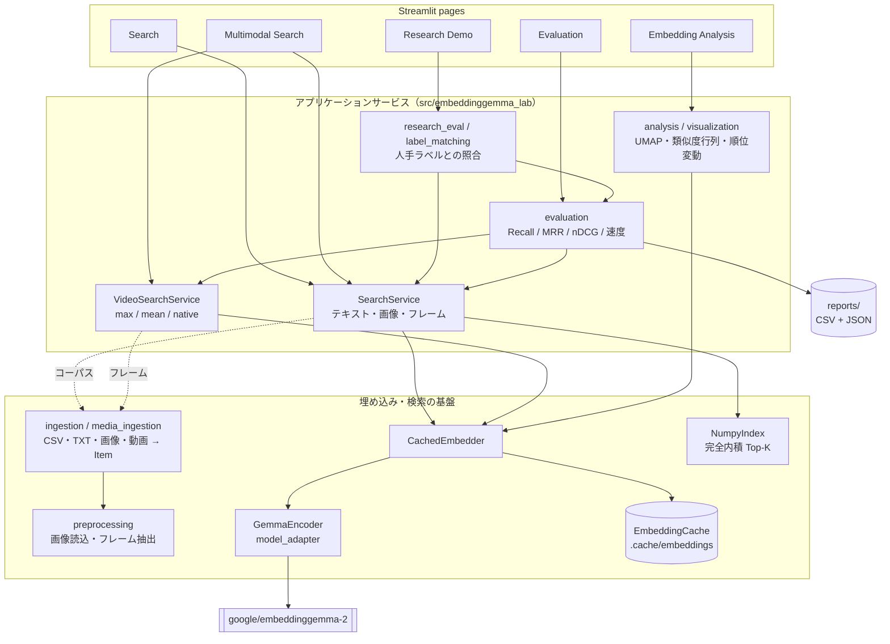
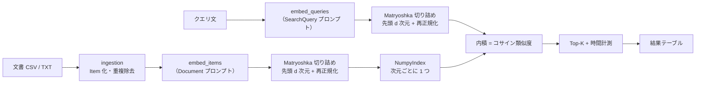
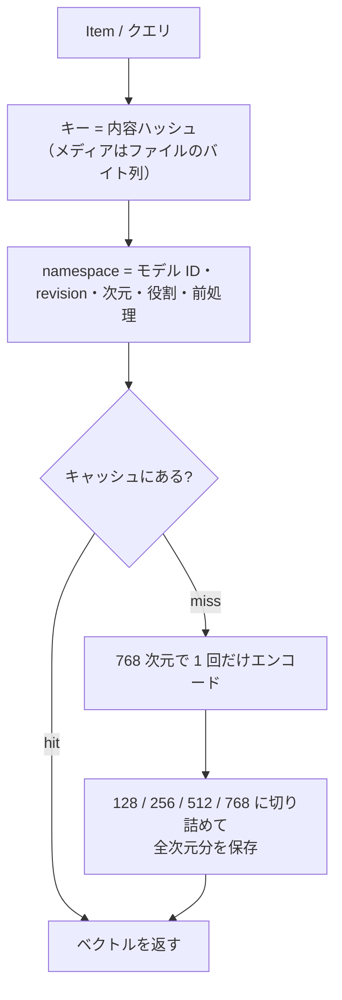
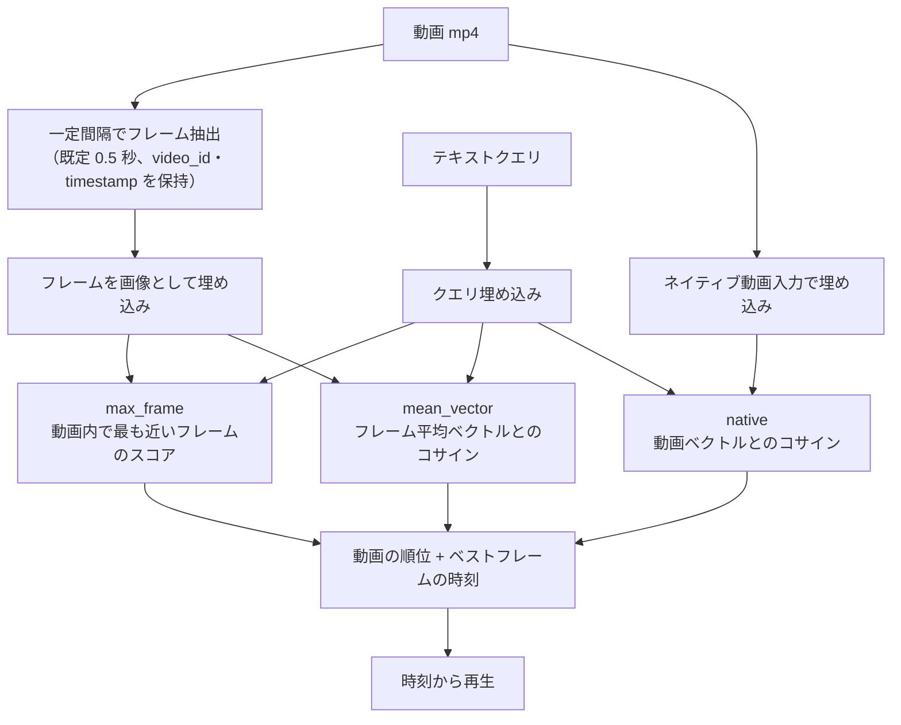
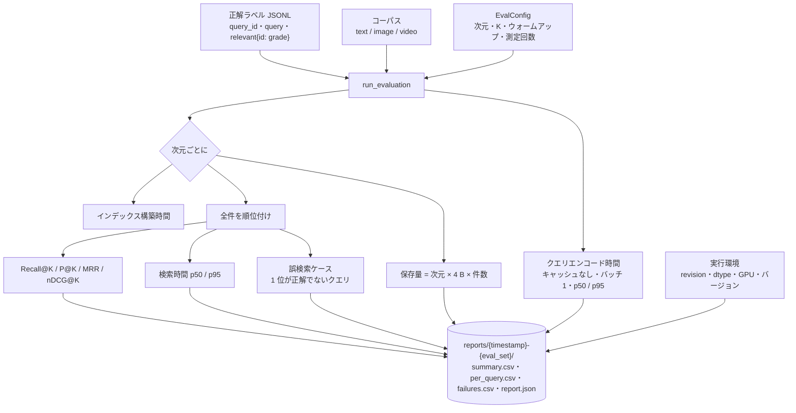
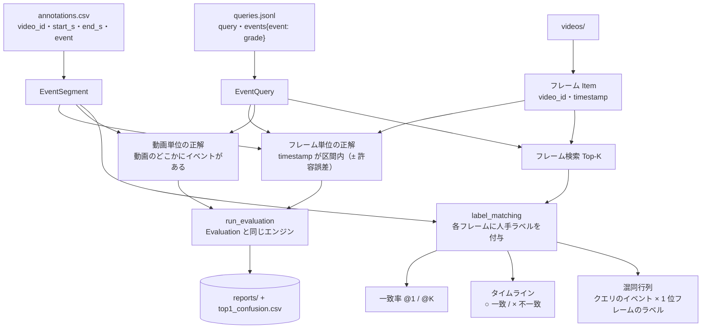
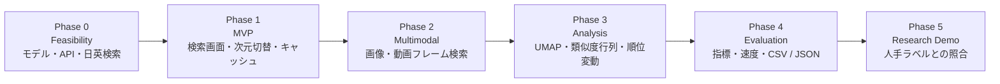

# EmbeddingGemma Multimodal Lab

`google/embeddinggemma-2` を使って、**テキスト・画像・動画の意味検索**と、
**Matryoshka 次元（128 / 256 / 512 / 768）ごとの品質・速度・保存量の違い**をローカルで確かめるデモです。

検索結果を見せるだけでなく、正解ラベル付きの評価セットと人手ラベルとの照合で
「どの次元・どの検索方式なら、どれだけ正しく、どれだけ速いか」を数値で比較できるようにしています。

- UI: Streamlit（5 ページ）
- パッケージ管理: uv
- 実行: ローカルのみ（外部の有料 API は使いません）
- 開発方針: [docs/development_policy.md](docs/development_policy.md) ／ 進捗: [todo.md](todo.md)

---

## 目次

1. [全体像](#全体像)
2. [クイックスタート](#クイックスタート)
3. [画面の使い方](#画面の使い方)
4. [処理の流れ](#処理の流れ)
5. [データ形式](#データ形式)
6. [評価の再実行（CLI）](#評価の再実行cli)
7. [参考結果](#参考結果)
8. [ディレクトリ構成](#ディレクトリ構成)
9. [テスト・品質チェック](#テスト品質チェック)
10. [動作環境と注意点](#動作環境と注意点)
11. [トラブルシューティング](#トラブルシューティング)
12. [制約と既知の問題](#制約と既知の問題)
13. [開発の進め方](#開発の進め方)

---

## 全体像



モデル固有の処理（プロンプト名、dtype、モダリティ別の入力形式）は `model_adapter.py` に閉じ込め、
それ以外のモジュールは `Encoder` プロトコルだけに依存します。ユニットテストでは決定的な `FakeEncoder` に差し替えます。
各モジュールの責務は [docs/architecture.md](docs/architecture.md) を参照してください。

---

## クイックスタート

### 1. 前提

- Python 3.12 と [uv](https://docs.astral.sh/uv/)
- （任意）CUDA 対応 GPU。bfloat16 対応 GPU なら bf16、それ以外は CPU / float32 で動きます
- システムの FFmpeg（サンプル動画の生成と、ネイティブ動画入力のデコードに使用）
- Hugging Face からモデルを取得できること。利用条件への同意が必要な場合は `uv run hf auth login` で認証してください

### 2. インストールと起動

```bash
uv sync                                   # 依存関係（uv.lock で固定）をインストール
uv run python scripts/smoke_text.py       # 5 件の文書で日英検索のスモークテスト（モデル取得を兼ねる）
uv run python scripts/smoke_multimodal.py # 画像・動画入力のスモークテスト（合成サンプルも生成）
uv run streamlit run app.py               # http://localhost:8501
```

初回起動時にモデルのダウンロードと、合成サンプル画像・動画の生成が行われます。
以降は埋め込みキャッシュが効くため、2 回目からはコーパスの再エンコードは発生しません。

### 3. GPU が埋まっている場合

```bash
EGLAB_DEVICE=cpu uv run streamlit run app.py
```

`EGLAB_DEVICE` には `cpu` / `cuda` / `cuda:1` などを指定できます（未指定なら CUDA があれば CUDA）。

---

## 画面の使い方

| ページ | できること |
|---|---|
| **Search** | 日英クエリで Top-K 検索。次元の切り替え、ラベル絞り込み、エンコード・検索・インデックス構築時間、キャッシュ hit / miss を表示 |
| **Multimodal Search** | テキスト → 画像、画像 → 画像、テキスト → 動画。動画は 3 つの集約方式を切り替え、ベストフレームの時刻から再生 |
| **Embedding Analysis** | UMAP 2D（ラベル / モダリティで色分け、クリック・投げ縄で詳細）、類似度行列、次元別の k 近傍一致率、クエリ別の順位変動（top-k overlap、Kendall τ、バンプチャート） |
| **Evaluation** | 評価セットで 4 次元を同じ条件で比較（Recall@K / MRR / nDCG@K / P@K、p50 / p95 レイテンシ、保存量）。誤検索の例、CSV / JSON の出力 |
| **Research Demo** | 把持の成功 / 滑り / 落下 / 持ち直しを動画フレームから検索し、人手ラベル（時間区間）と照合。一致率、タイムライン、1 位フレームの混同行列、4 次元評価 |

### 代表的なデモの流れ

1. **Search** で「ロボットが物体を落とす」と入力し、日本語・英語の文書が両方ヒットすることを確認する
2. 次元を 768 → 128 に変えて、順位とスコアがどう変わるかを見る
3. **Embedding Analysis** で UMAP と類似度行列を見て、カテゴリのまとまりと混同を確認する
4. **Evaluation** で 4 次元の nDCG@10 と検索時間・保存量を並べて比較する
5. **Multimodal Search** の「テキスト → 動画」で「the robot drops the block」を検索し、ベストフレームの時刻から再生する
6. **Research Demo** で、検索で得たフレームが人手ラベルの「落下」区間に入っているか（○ / ×）を確認する

> スコアはコサイン類似度で、**関連度の指標であり正解確率ではありません。**

---

## 処理の流れ

### テキスト検索（Search）



- クエリと文書はモデルが定める別々のプロンプト（`SearchQuery` / `Document`）でエンコードします。
- 切り詰めは 768 次元の正規化済みベクトルの先頭を切り出して再正規化します（`truncate_dim` + `normalize_embeddings` と等価）。

### 埋め込みキャッシュ



- 保存先は `.cache/embeddings/<namespace>/<content-hash>.npy`（Git 管理外）。
- 1 回のエンコードで全次元分を保存するので、次元を切り替えても再エンコードは発生しません。
- モデルの revision が変わると namespace も変わり、自動的に別キャッシュになります。

### 動画検索（Multimodal Search / Research Demo）



平均ベクトルでは短い「滑った瞬間」が薄まりやすいため、フレーム単位の最大スコアと比較できるようにしています。

### 評価（Evaluation）



定義と測定方法の詳細は [docs/evaluation_protocol.md](docs/evaluation_protocol.md) にあります。
同じ設定で再実行すると、品質指標は完全に一致します。

### 人手ラベルとの照合（Research Demo）



正解をアイテムごとに手で書くのではなく、時間区間のアノテーションから自動で導出します。
そのため、ラベルを 1 か所直せばフレーム単位・動画単位の両方の評価に反映されます。

---

## データ形式

### 文書（Search / Embedding Analysis / Evaluation）

サイドバーで「サンプル文書（日英 41 件、10 カテゴリ）」か CSV / TXT のアップロードを選びます。

| 形式 | ルール |
|---|---|
| CSV | `text`（または `content` / `body` / `document`）列が必須。任意で `doc_id` / `title` / `category`（ラベルとして使用）。それ以外の列はメタデータとして保持 |
| TXT | 空でない 1 行が 1 文書 |

```csv
doc_id,title,text,category,lang
g01,把持成功,ロボットハンドが赤いブロックをしっかり掴み、そのまま箱の中へ運んだ。,grasp_success,ja
```

### 画像・動画

`metadata.csv` は任意で、無い場合はファイル名がそのまま ID になります。

```csv
media_id,file,caption,label
img_red_circle,img_red_circle.png,a red circle,shape
```

サイドバーから追加した画像・動画は `datasets/uploads/` に内容ハッシュ付きの名前で保存されます（Git 管理外、同じファイルの再アップロードは重複しません）。

### 評価セット（Evaluation）

`datasets/sample/eval/{text,image,video}.jsonl`。1 行 1 クエリで、`relevant` は段階的な関連度（2 = 正解、1 = 部分的に関連）です。

```json
{"query_id": "t01", "query": "ロボットが物体を落とす", "relevant": {"d01": 2, "d02": 2, "r03": 1}}
```

Evaluation ページから独自の JSONL をアップロードすることもできます（コーパスに無い ID は警告されます）。

### 研究デモ用データセット（Research Demo）

```text
<root>/
├── videos/            # *.mp4（任意で metadata.csv）
├── annotations.csv    # 人手ラベル。区間は重複してよい
└── queries.jsonl      # イベントクエリ
```

```csv
video_id,start_s,end_s,event,annotator
vid_slip_red,1.5,2.3,carry,alice
vid_slip_red,2.3,4.0,slip,alice
```

```json
{"query_id": "r07", "query": "the gripper regrasps the block after it slipped", "events": {"regrasp": 2, "slip": 1}}
```

- `events` の grade は正解の重み（区間に複数のイベントが重なる場合は最大値）。
- ページのサイドバーでディレクトリを指定するか、CLI の `--root` で渡します。空欄なら同梱の合成サンプルを使います。
- ラベルの無い動画、動画が見つからないラベルは画面に警告されます。

---

## 評価の再実行（CLI）

### 評価セット（text / image / video）

```bash
uv run python scripts/run_evaluation.py --task text
uv run python scripts/run_evaluation.py --task image
uv run python scripts/run_evaluation.py --task video --video-method max_frame      # mean_vector / native
uv run python scripts/run_evaluation.py --task video --frame-interval 0.25 --repeats 10
```

### 人手ラベルとの照合

```bash
uv run python scripts/run_research_eval.py --granularity frame                     # フレーム単位
uv run python scripts/run_research_eval.py --granularity video --video-method mean_vector
uv run python scripts/run_research_eval.py --root datasets/robot_grasps --tolerance 0.5
```

| 主なオプション | 既定値 | 意味 |
|---|---|---|
| `--dims` | `128 256 512 768` | 比較する次元 |
| `--ks` | `1 5 10` | Recall@K などの K |
| `--warmup` / `--repeats` | `2` / `5` | 速度測定のウォームアップ回数と測定回数 |
| `--frame-interval` | `0.5` | 動画のフレーム抽出間隔（秒） |
| `--tolerance` | `0.25` | （研究デモ）フレーム時刻と区間の許容誤差（秒） |
| `--out` | `reports/<timestamp>-<name>/` | 出力先 |

出力ファイル:

| ファイル | 内容 |
|---|---|
| `summary.csv` | 次元ごとの品質指標・レイテンシ・保存量 |
| `per_query.csv` | クエリ × 次元ごとの指標 |
| `failures.csv` | 1 位が正解でなかったクエリ（期待した正解と実際の上位） |
| `report.json` | 上記すべて + 実行環境・設定 |
| `top1_confusion.csv` | （研究デモのみ）クエリのイベント × 1 位フレームの人手ラベル |

---

## 参考結果

RTX A1000 8GB、bfloat16、モデル revision `914f7f8`。

| 評価セット | 指標 | 128 | 256 | 512 | 768 |
|---|---|---|---|---|---|
| text（20 クエリ / 41 文書） | nDCG@10 | 0.905 | 0.907 | 0.917 | 0.916 |
| image（14 クエリ / 17 枚） | nDCG@10 | 0.948 | 0.965 | 0.965 | 0.948 |
| video max_frame（8 クエリ / 8 本） | nDCG@10 | 0.614 | 0.677 | 0.630 | 0.653 |
| research フレーム単位（8 クエリ / 64 フレーム） | P@1 | 0.125 | 0.125 | 0.125 | 0.125 |
| research フレーム単位（8 クエリ / 64 フレーム） | nDCG@10 | 0.093 | 0.138 | 0.102 | 0.138 |
| research 動画単位 max_frame（8 クエリ / 8 本） | nDCG@10 | 0.741 | 0.759 | 0.730 | 0.738 |
| — | 保存量 / ベクトル | 512 B | 1 KB | 2 KB | 3 KB |

- クエリエンコードは p50 約 19〜22 ms で、次元に依存しません（切り詰めはエンコード後のため）。検索は全次元で 0.03〜0.04 ms 程度です。
- サンプルは小規模なため、次元間の差は誤差の範囲です（#7）。
- 合成動画では状態の区別が難しく、研究デモでは 1 位フレームがほぼ全クエリで「落下」区間に偏ります（#6, #15）。

---

## ディレクトリ構成

```text
embeddinggemma-multimodal-lab/
├── app.py                      # Streamlit のエントリーポイント（ページ一覧のみ）
├── pages/                      # 1_Search / 2_Multimodal_Search / 3_Embedding_Analysis / 4_Evaluation / 5_Research_Demo
├── src/embeddinggemma_lab/
│   ├── config.py               # モデル ID・対応次元・パス
│   ├── device.py               # CPU / CUDA と dtype の選択（float16 は使わない）
│   ├── model_adapter.py        # Encoder プロトコルと GemmaEncoder
│   ├── matryoshka.py           # 切り詰め + 再正規化、保存量
│   ├── ingestion.py            # Item、CSV / TXT 取り込み、重複除去
│   ├── preprocessing.py        # 画像読込、フレーム抽出
│   ├── media_ingestion.py      # 画像・動画 → Item、フレーム Item
│   ├── sample_media.py         # 合成サンプル画像・動画の生成
│   ├── embedding_cache.py      # .npy ディスクキャッシュ
│   ├── embedding_service.py    # CachedEmbedder
│   ├── retriever.py            # NumpyIndex
│   ├── search_service.py       # クエリ → 順位付き結果
│   ├── video_search.py         # max_frame / mean_vector / native
│   ├── analysis.py             # 近傍一致率・順位変動
│   ├── visualization.py        # UMAP・Plotly 図
│   ├── metrics.py              # Recall / P / MRR / nDCG
│   ├── evaluation.py           # 評価エンジン・レポート出力
│   ├── eval_sets.py            # 組み込み評価セット
│   ├── environment.py          # 実行環境の記録
│   ├── annotations.py          # 人手ラベル（時間区間）
│   ├── event_queries.py        # イベントクエリと正解の導出
│   ├── label_matching.py       # 検索結果と人手ラベルの照合
│   ├── research_corpus.py      # 研究デモ用データセット
│   ├── research_eval.py        # フレーム / 動画単位の評価、混同表
│   ├── research_plots.py       # タイムライン・混同行列
│   └── ui/                     # Streamlit 依存のヘルパー（コアは Streamlit に依存しない）
├── scripts/                    # smoke_text / smoke_multimodal / run_evaluation / run_research_eval
├── datasets/sample/
│   ├── documents.csv           # 日英 41 文書
│   ├── eval/                   # text / image / video の正解ラベル
│   ├── research/               # 合成動画用の区間ラベルとイベントクエリ
│   ├── images/  videos/        # 合成メディア（自動生成、Git 管理外）
├── tests/                      # pytest（FakeEncoder でモデル不要）
├── docs/                       # 開発方針・アーキテクチャ・評価プロトコル
└── reports/  .cache/           # 評価結果・埋め込みキャッシュ（Git 管理外）
```

---

## テスト・品質チェック

```bash
uv run pytest -m "not model"              # モデル不要のユニットテスト（CI と同じ）
uv run pytest -m model                    # 実モデルを使う統合テスト（初回はモデルをダウンロード）
EGLAB_DEVICE=cpu uv run pytest -m model   # GPU が埋まっている場合
uv run ruff check . && uv run ruff format --check .
```

- ユニットテストは単語の袋（bag-of-words）のハッシュで決定的なベクトルを返す `FakeEncoder`（`tests/fakes.py`）を使い、モデルなしで実行できます。
- 指標は手計算した値と照合しています（`tests/test_metrics.py`）。
- GitHub Actions で `ruff check`・`ruff format --check`・`pytest -m "not model"` を実行します。

---

## 動作環境と注意点

| 項目 | 値 |
|---|---|
| モデル | `google/embeddinggemma-2` @ `914f7f8` |
| Python | 3.12 |
| torch / transformers / sentence-transformers | 2.14.1 / 5.20.0 / 6.1.0 |
| GPU | NVIDIA RTX A1000 8GB（bfloat16） |

- モデルカードの指示により **float16 は使いません**（NaN になるため）。bf16 対応の CUDA なら bfloat16、それ以外は float32 です。
- テキストだけを使う場合でも、プロセッサの初期化に `pillow` と `torchvision` が必要です（#10）。
- ネイティブ動画入力のデコードには `torchcodec` とシステムの FFmpeg 共有ライブラリが必要です。フレーム抽出は FFmpeg 同梱の OpenCV で行います。
- サンプル動画は FFmpeg があれば H.264（ブラウザで再生可能）、無ければ OpenCV の mp4v で書き出します。

---

## トラブルシューティング

| 症状 | 対処 |
|---|---|
| `CUDA out of memory` | 他プロセスが GPU を使っている可能性があります。`EGLAB_DEVICE=cpu` で起動してください（自動フォールバックは未対応、#11） |
| モデルのダウンロードで 401 / 403 | Hugging Face でモデルの利用条件に同意し、`uv run hf auth login` で認証してください |
| ネイティブ動画方式でデコードエラー | システムに FFmpeg（共有ライブラリ）を入れてください。フレーム方式（max_frame / mean_vector）は OpenCV だけで動きます |
| 動画がブラウザで再生できない | FFmpeg を入れてから `datasets/sample/videos/` を削除して再起動すると、H.264 で再生成されます |
| 2 回目以降のエンコード時間がほぼ 0 ms | クエリ埋め込みもキャッシュされるためです（#12）。純粋なエンコード時間は Evaluation の「クエリエンコード」を見てください |
| キャッシュを消したい | `.cache/embeddings/` を削除してください（容量管理は未実装、#13） |

---

## 制約と既知の問題

- 同梱サンプルは小規模な合成データです。実ロボットの把持動画と、人が動画を見て付けたラベルは同梱していません（#14）。
- EmbeddingGemma 2 は埋め込みモデルであり、時系列の失敗予測モデルではありません。スコアは「失敗の発生確率」ではありません。
- UMAP は非線形な 2 次元射影です。点の距離を高次元の意味的な距離と同一視しないでください。
- 既知の問題は GitHub Issues と [todo.md](todo.md) にまとめています。

| Issue | 内容 |
|---|---|
| #6 | 合成グリッパ動画の検索がチャンスレベル |
| #7 | サンプル評価セットが易しく、次元差が出ない |
| #8 | 「滑り」クエリで「落下」文書が 1 位になる |
| #9 | 類似度に言語による上乗せがある |
| #10 | 依存関係の注意点（pillow / torchvision / torchcodec / FFmpeg） |
| #11 | CUDA OOM 時に CPU へ自動フォールバックしない |
| #12 | Search 画面のエンコード時間がキャッシュの影響を受ける |
| #13 | 埋め込みキャッシュのスケーラビリティと容量管理 |
| #14 | 実ロボット把持動画と人手ラベルが未同梱 |
| #15 | 合成動画では 1 位フレームが「落下」区間に偏る |
| #16 | `corpus_digest` がパスを含まず、別データセットの同名フレームで索引が共有されうる |

---

## 開発の進め方



- 各 Phase は `feature/phaseN-*` ブランチで実装し、PR で取り込みます。見つかった問題は Issue にします。
- 関数・クラスは小さく、単一責務（SOLID）を守ります。モデル依存は `model_adapter.py`、Streamlit 依存は `ui/` とページに閉じ込めます。
- 生データ・モデルの重み・生成した埋め込み・個人情報は Git で管理しません。
