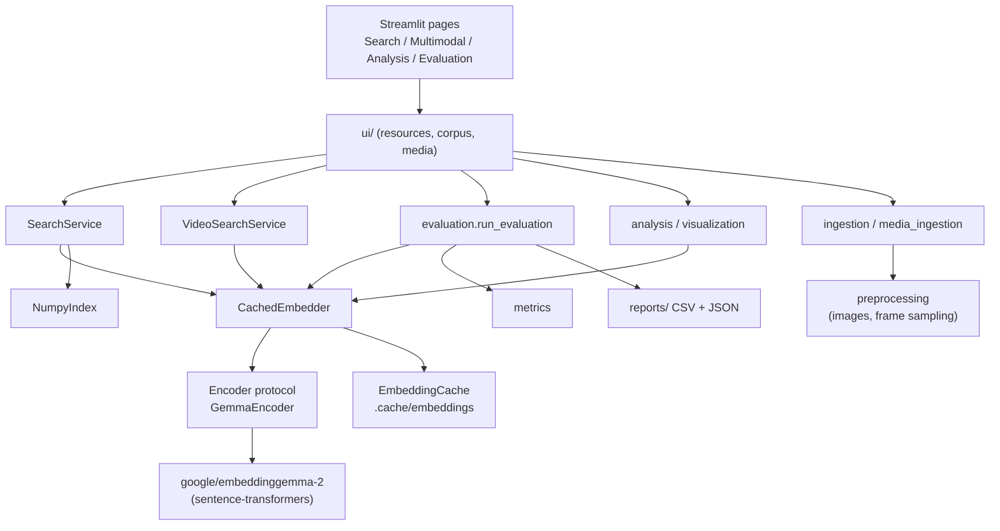

# アーキテクチャ

## モジュール

| モジュール | 責務 |
|---|---|
| `config.py` | モデル ID、対応次元、パス、`ModelSettings` |
| `device.py` | デバイス・dtype 選択（fp16 禁止）、`EGLAB_DEVICE` |
| `model_adapter.py` | `Encoder` プロトコルと `GemmaEncoder`。プロンプト名・文書フォーマット・エンコーダの選択ロードを閉じ込める |
| `matryoshka.py` | 先頭切り出し + 再正規化、保存量 |
| `ingestion.py` | `Item`、CSV / TXT 取り込み、内容ハッシュ、重複除去 |
| `preprocessing.py` | 画像読み込み、動画の一定間隔フレーム抽出、ファイルハッシュ |
| `media_ingestion.py` | 画像・動画フォルダ → `Item`、フレーム `Item`（video_id / timestamp）、アップロード保存 |
| `sample_media.py` | 合成サンプル画像・動画の決定的生成 |
| `embedding_cache.py` | namespace（モデル・revision・次元・役割・前処理）× 内容ハッシュの `.npy` キャッシュ |
| `embedding_service.py` | `CachedEmbedder`：768 次元で 1 回エンコードし全次元を保存、テキスト・メディア混在対応 |
| `retriever.py` | `NumpyIndex`（完全内積 Top-K、マスク） |
| `search_service.py` | クエリ → 順位付き結果 + 時間計測、画像 → 画像 |
| `video_search.py` | フレーム最大スコア / フレーム平均ベクトル / ネイティブ動画 |
| `analysis.py` | k 近傍一致率、次元別順位、Kendall τ |
| `visualization.py` | UMAP、Plotly 図 |
| `metrics.py` | Recall@K / P@K / MRR / nDCG@K |
| `evaluation.py` | 評価実行・誤検索抽出・CSV / JSON 出力 |
| `eval_sets.py` | 組み込み評価セット（text / image / video） |
| `environment.py` | 実行環境の記録 |
| `ui/` | Streamlit 依存のヘルパー（コアモジュールは Streamlit に依存しない） |

## 設計上の判断

- **1 回のエンコードで全次元を賄う**：モデルカードの `truncate_dim` + `normalize_embeddings` と等価な「切り出し + 再正規化」を自前で行い、
  768 次元の結果から 4 次元すべてをキャッシュする。次元切り替えで再エンコードが発生しない。
- **キャッシュキーの分離**：namespace にモデル ID・revision・次元・役割（query / document）・前処理条件、
  ファイル名に内容ハッシュ（メディアはファイルバイト列）。revision が変われば自動的に別キャッシュになる。
- **モデル依存を adapter に閉じ込める**：テストは決定的な `FakeEncoder` で行い、実モデルのテストは `-m model` に分離。
