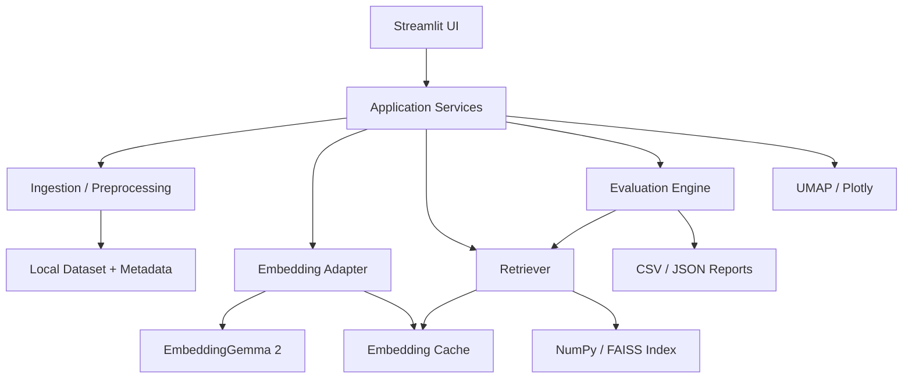

# EmbeddingGemma Multimodal Lab — 開発方針

## 1. 目的

Google の `google/embeddinggemma-2` を利用して、**テキスト・画像・動画・音声の意味検索**と**埋め込み表現の可視化・品質評価**を体験できるローカルデモを開発する。

- **アプリ名**: EmbeddingGemma Multimodal Lab
- **GitHub リポジトリ名**: `embeddinggemma-multimodal-lab`
- **UI**: Streamlit
- **Python パッケージ／仮想環境管理**: uv
- **実行方針**: ローカルファースト。外部有料 API は必須としない。
- **主目的**: 検索結果を見せるだけでなく、ベクトル次元、検索方式、入力モダリティによる品質・性能差を定量的に確認する。

## 2. スコープ

### MVP（必須）

1. テキスト文書の投入（組み込みサンプルまたは CSV / TXT）
2. 日本語・英語クエリによる意味検索（Top-K）
3. モデル推奨のクエリ／文書用プロンプト・API を使い分ける
4. Matryoshka 次元の切り替え（128 / 256 / 512 / 768）
5. コサイン類似度（正規化時は内積）と検索順位の表示
6. 埋め込みのキャッシュと再利用
7. UMAP 2D 散布図と選択文書の確認
8. 正解ラベル付き評価セットによる Recall@K / MRR / nDCG@K / 推論時間の比較

### 拡張（段階導入）

- 画像・テキスト横断検索：テキスト → 画像、画像 → 画像
- 動画検索：動画を規則的にフレーム抽出し、フレーム埋め込みを集約する方式をベースラインとする。モデルのネイティブ動画 API が実際に利用可能か検証し、対応時に比較する。
- 音声検索：公式の音声入力仕様・前処理・デコーダ要件を確認したうえで追加
- 検索バックエンド：小規模データは NumPy、大規模化時は FAISS
- BM25 対 dense embedding、必要に応じてハイブリッド検索の比較
- ロボット把持成功／滑り／落下／回復動画を対象とする研究デモ

> 注意：モデルカードに明示されていない入力仕様や `SentenceTransformer` の引数を実装の前提にしない。マルチモーダル API とモデルバージョンの互換性は、各フェーズの冒頭で小さな実行テストにより確認する。

## 3. 対象ユーザーとユースケース

- **AI / RAG エンジニア**：Embedding 次元ごとの精度・レイテンシ・保存量を比較する。
- **研究者**：類似データの分布を可視化し、失敗ケースを分析する。
- **デモ閲覧者**：自然言語で画像・動画を探し、検索結果を直感的に理解する。

代表シナリオ：

1. 「ロボットが物体を落とす」と入力する。
2. 登録した文書や動画フレームから関連する候補を返す。
3. Top-K 結果とスコアを確認する。
4. 次元を 128 / 256 / 512 / 768 に変更し、検索順位と精度の変化を比較する。
5. UMAP のクラスタを観察し、誤検索・難例を分析する。

## 4. 画面設計

### Tab A — Semantic Search

- クエリ入力（初期はテキスト、後に画像・動画・音声アップロード）
- データセット選択、Top-K、埋め込み次元、フィルタ
- 結果一覧：順位、スコア、テキスト／サムネイル、元データへの参照
- 検索・エンコード時間の表示

### Tab B — Embedding Analysis

- UMAP 2D 分布（モダリティ・正解ラベル別の色分け）
- クラスタやサンプル選択による詳細表示
- 類似度行列（ヒートマップ）
- 次元別の近傍変化・ランク変動分析

### Tab C — Evaluation

- 正解データ付き評価セットの選択・投入
- Recall@K、MRR、nDCG@K、P@K の集計
- 次元別の推論レイテンシ・メモリ使用量・保存量
- 評価結果の CSV / JSON エクスポート
- 誤検索ケースの例示（クエリ、期待正解、検索結果）

### Tab D — Dataset Manager（Phase 2 以降）

- 文書・画像・動画・音声の追加
- インデックス構築状態とモデル設定の表示
- ハッシュを使った重複除去、データ削除、再インデックス

## 5. 技術アーキテクチャ



### 推奨技術

| 機能 | 技術 | 備考 |
|---|---|---|
| UI | Streamlit | `st.cache_resource` でモデル保持 |
| 依存関係管理 | uv | `pyproject.toml` と `uv.lock` を管理 |
| モデル実行 | PyTorch / Transformers / Sentence Transformers | モデルカード記載のサポート経路を優先 |
| 類似度検索 | NumPy → FAISS | 小規模から開始 |
| 可視化 | Plotly / UMAP | 評価セットに基づく散布図 |
| 定量評価 | NumPy / pandas / scikit-learn | 独自検索指標はテスト付き実装 |
| データ保存 | ローカルファイル / Parquet | キャッシュとメタデータを分離 |
| 品質保証 | pytest / ruff | ローカルと CI で同一のチェック |

## 6. リポジトリ構成

```text
embeddinggemma-multimodal-lab/
├── app.py
├── pyproject.toml
├── uv.lock
├── README.md
├── docs/
│   ├── development_policy.md
│   ├── architecture.md
│   └── evaluation_protocol.md
├── src/embeddinggemma_lab/
│   ├── config.py
│   ├── model_adapter.py
│   ├── preprocessing.py
│   ├── ingestion.py
│   ├── embedding_cache.py
│   ├── retriever.py
│   ├── evaluation.py
│   └── visualization.py
├── pages/
│   ├── 1_Search.py
│   ├── 2_Embedding_Analysis.py
│   └── 3_Evaluation.py
├── datasets/
│   └── sample/
├── tests/
│   ├── test_retriever.py
│   ├── test_metrics.py
│   └── test_cache.py
└── .gitignore
```

`app.py` はエントリーポイントに限定し、モデル読み込み・エンコード・検索・評価は `src/` に分離する。生データ、モデル重み、生成した埋め込みと個人情報を Git 管理しない。

## 7. 実装上の方針

### 7.1 モデルの利用

- モデル ID：`google/embeddinggemma-2`
- 初回起動時にはモデルのダウンロード、認証・利用条件、必要メモリ、ライブラリの互換性を確認する。
- デバイスを CPU / CUDA から判定し、モデル対応精度（dtype）でロードする。
- モデル API で定義された文書用・クエリ用プロンプトがある場合は明示的に使い分ける。
- テキストと画像等で必要な前処理を独立モジュールとし、推論モデル変更を容易にする。
- **検索スコアは関連度の指標であり、正解確率として表示しない。**

### 7.2 Matryoshka 次元比較

- 128 / 256 / 512 / 768 次元で同一クエリ・同一評価セットを比較する。
- 正規化と次元切り詰めの順序はモデル推奨 API に従う。
- 次元ごとにインデックスを管理し、キャッシュキーへモデル ID・revision・次元・前処理条件を含める。
- ベクトル単体の概算保存量（float32）：128次元 512B、256次元 1KB、512次元 2KB、768次元 3KB（メタデータ・インデックス構造は除く）。

### 7.3 評価の再現性

- 検索クエリと文書 ID に紐づく relevance judgments（正解ラベル）を JSONL/CSV に保存する。
- 実行時のモデル revision、ハードウェア、dtype、次元、バッチサイズ、検索方式を記録する。
- ウォームアップ後に複数回測定し、p50 / p95 を集計する。
- 推論時間、インデックス構築時間、検索時間を別々に報告する。
- UMAP は非線形な二次元可視化であり、点間距離をそのまま高次元の意味的距離と断定しない。

### 7.4 動画への応用

- Phase 2 では動画を一定間隔でサンプリングし、各フレームのメタデータ（動画 ID・timestamp）を保存する。
- テキスト検索 → フレーム候補 → タイムスタンプ付き動画再生を最低限の完成形とする。
- 動画全体でベクトル平均する方法もベースラインにするが、短い「滑った瞬間」が消える可能性があるため、フレーム単位の最大スコア集約と比較する。
- EmbeddingGemma 2 自体を時系列失敗予測モデルとみなさない。

## 8. セットアップと実行

```bash
uv init embeddinggemma-multimodal-lab
cd embeddinggemma-multimodal-lab
uv add streamlit torch transformers sentence-transformers \
  numpy pandas plotly umap-learn scikit-learn
uv add --dev pytest ruff
uv run streamlit run app.py
```

> 実装前に、モデルカードの推奨ライブラリバージョン・推論コード・サポート対象モダリティを確認し、動作検証済みの依存関係を `uv.lock` に固定する。実行時にモデルアクセスの許可が必要な場合は、Hugging Face の認証手続きを行う。

## 9. 開発フェーズと完了条件

| Phase | 内容 | 完了条件 |
|---|---|---|
| 0 — Feasibility | モデル取得・推論 API・ハードウェア・日本語検索を検証 | 5件の文書に対する検索がローカルで実行できる |
| 1 — MVP | Streamlit検索、次元切替、ベクトルキャッシュ | Top-Kと検索時間が表示され、再起動後もキャッシュを再利用できる |
| 2 — Multimodal | 画像検索と動画フレーム検索 | クエリで画像・関連動画区間を取得できる |
| 3 — Analysis | UMAP、類似度行列、順位変動 | 次元別の分布と検索順位を比較できる |
| 4 — Evaluation | 正解セット、Recall@K / MRR / nDCG、速度比較 | 4次元の測定結果を同条件で再実行・CSV出力できる |
| 5 — Research Demo | 把持成功・失敗のロボット動画サンプル | 成功／落下／滑りの検索結果を人手ラベルと照合できる |

## 10. 開発優先度・対象外

**優先度 P0**：ローカル起動、モデル安定稼働、テキスト検索、次元比較、キャッシュ、テスト。

**優先度 P1**：画像検索、動画検索、UMAP、評価レポート。

**優先度 P2**：音声、BM25ハイブリッド、FAISS、ロボット研究データ連携。

初期フェーズで**対象外**とするもの：ユーザー認証、クラウドデプロイ、分散学習、モデルの追加学習、Agent 機能、VLA の動作生成。

## 11. リスクと対策

| リスク | 対策 |
|---|---|
| メモリ不足・推論が遅い | 小さなバッチ、CPUモード、事前エンコード、キャッシュ、対応dtypeの検証 |
| モダリティ別 API の変更 | model adapter に閉じ込め、スモークテストで検知 |
| 検索精度が高く見えるだけ | 人手で作成した正解ラベルと難例を用意し、定量評価する |
| UMAPの見かけのクラスタを過信 | 元の類似度・正解ラベル・検索順位との整合性を確認 |
| 動画の短い失敗瞬間を見落とす | フレーム間隔と集約方式の比較、timestamp付き検索 |
| 著作権・機密データの混入 | 公開可能なサンプルのみ同梱し、アップロードファイルをローカル管理 |

## 12. 最初の実装タスク（チェックリスト）

- [ ] `uv` プロジェクトと `src/` 構成を作成
- [ ] モデルカード推奨コードでテキストのスモークテスト
- [ ] CPU / CUDA 判定とモデル読み込みキャッシュ
- [ ] サンプル文書セットと正解クエリを作成
- [ ] クエリ・文書のエンコード API を統一
- [ ] コサイン類似度 Top-K を実装
- [ ] 128 / 256 / 512 / 768 次元切り替え
- [ ] Streamlit 検索画面を実装
- [ ] Recall@K / MRR / nDCG のユニットテスト
- [ ] UMAP散布図と比較グラフ
- [ ] モデル revision・dtype・計測環境を記録
- [ ] README に動かし方、制約、デモ用データを記載

## 13. 成果物

1. `uv run streamlit run app.py` で起動できるアプリ
2. デモ用サンプルデータと評価セット
3. 次元別精度・時間・保存量の比較画面
4. 再現可能な評価レポート（CSV / JSON）
5. セットアップと設計思想を説明した README と本開発方針

---

**開発原則**：まず動作を確認し、検索品質を測り、マルチモーダルへ拡張する。デモの見た目と評価の再現性を両立させる。
